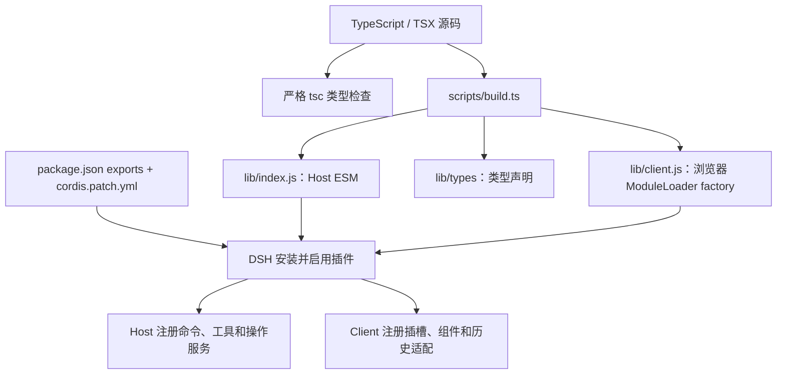
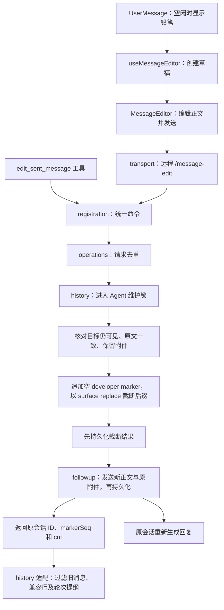

# 消息编辑插件的入口与流程

维护源码入口为 `src/host/index.ts` 和 `src/client/index.tsx`。构建脚本将它们编译为 `lib/index.js` 和 `lib/client.js`；DSH 根据包的 `exports` 加载这些产物。`cordis.patch.yml` 负责把插件加入宿主配置，不承载业务逻辑。

## 模块边界

```text
src/
├── shared/protocol.ts          请求、响应、内容块、截断范围与公共常量
├── host/
│   ├── index.ts                组装操作服务，注册卸载清理
│   ├── registration.ts         /message-edit 命令和 edit_sent_message 工具
│   ├── operations.ts           列表、请求去重、服务生命周期
│   ├── history.ts              锁内校验、截断、持久化与重新发送
│   ├── content.ts              提取文本、替换正文、保留附件
│   ├── validation.ts           unknown 输入与历史事件的边界检查
│   ├── types.ts                本插件实际使用的 DSH 服务接口
│   └── core.ts                 导出回归测试使用的核心函数
└── client/
    ├── index.tsx               注册 Client 插槽和样式
    ├── context.ts              Client 使用的宿主服务接口
    ├── types.ts                消息、附件及组件参数
    ├── transport.ts            UI 到 /message-edit 的唯一调用通道
    ├── content.ts              转换宿主 user-content Factory 参数
    ├── locales.ts              界面翻译及键名类型
    ├── styles.css              插件样式
    ├── components/
    │   ├── UserMessage.tsx     消息组件组合与空闲状态判断
    │   ├── MessageActions.tsx  时间、复制和铅笔
    │   ├── MessageEditor.tsx   输入框、快捷键、取消和发送
    │   └── Icon.tsx            复制、勾选和铅笔图标
    ├── hooks/useMessageEditor.ts  草稿、提交锁、请求重试和错误状态
    └── history/
        ├── results.ts         读取历史命令的 JSON 结果
        ├── cuts.ts            校验截断范围、过滤轮次提纲
        ├── builder.ts         包装原生 ChatSnapshotBuilder
        ├── install.ts         安装包装、重建已保留会话、卸载恢复
        ├── types.ts           隔离 DSH 0.2.2 私有接口
        └── index.ts           历史适配层的统一导出
```

Host 和 Client 只通过共享协议及宿主命令通信，浏览器不导入 Host 实现。正文和附件的最终显示继续复用宿主的 user-content Factory；历史适配集中在 `history/`，不接触其他插件的 DOM。

## 构建与加载



构建不压缩代码，产物顶部会标记来源；前端仅将 `react` 留给宿主注入，其余本地模块和 CSS 都打入自包含脚本。`lib/core.js`、`lib/visibility.js` 是回归入口，复用相同 TypeScript 模块，不维护第二套实现。构建不需要 DSH 源码，完整原生回归才依赖固定的参考源码。

## 编辑与重新生成



关键顺序是 `runMaintenance → 截断 → flush → followup → flush`。进入维护锁之后再次校验目标，避免原文已变更时误改；同一请求 ID 缓存同一个 Promise，重复点击和工具重试只能提交一次。

截断 marker 写入后的失败不能假装历史未改变：结果会携带 `historyChanged`、`accepted` 和错误信息，界面保留提示。旧审计日志不会物理删除，已执行的文件修改、命令和外部操作也不会回滚。

## 开发验证

- `pnpm typecheck`：严格检查所有维护源码与构建/测试脚本。
- `pnpm build`：生成 Host、Client、回归入口及类型声明。
- `pnpm test`：先构建，再对编译产物执行行为测试、真实 DSH 参考组件测试和 React 交互测试。
- `pnpm check`：类型检查与完整测试，CI 使用同一命令；CI 另检查构建后 `lib/` 无差异。

兼容目标仍为 DSH `0.2.2-rc.1`。更换宿主版本时，优先复验 `client/history/` 的私有接口，并对实际发行版执行现场验收。
